
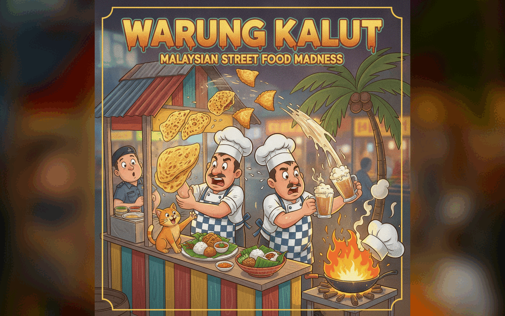

# Warung Kalut

A chaotic, co-op cooking game about Malaysian street food, inspired by Overcooked 2. Chop, mix, fry and boil your way through a warung while orders pile up, and learn what each dish is made of along the way.

Made in Godot 4.7 (GL Compatibility renderer, GDScript) for the Xsolla game jam.

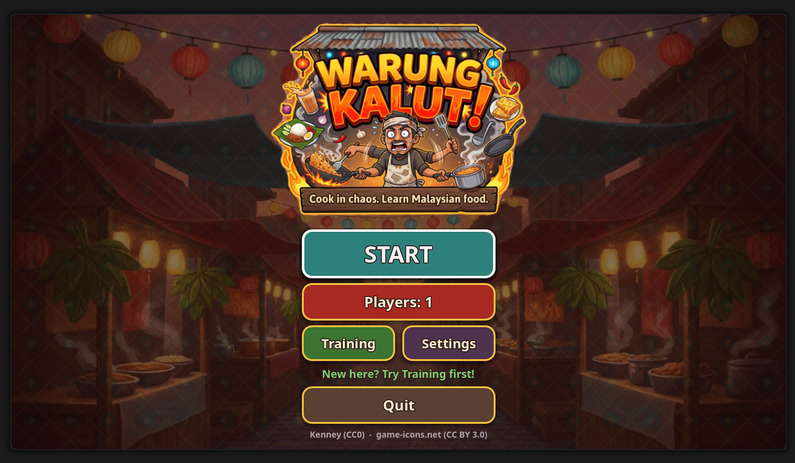

## What it teaches

Malaysia is a food culture built from Malay, Chinese and Indian traditions. Each dish in the game comes with a short note, shown in the recipe book, on the pause screen and on the end screen:

- **Roti Jala** ("net bread"): batter poured through a perforated cup into a lacy crepe, eaten with curry. A Ramadan bazaar favourite.
- **Karipap** (curry puff): a crimped, deep-fried pastry of spiced chicken, potato and onion. A teatime snack.
- **Nasi Lemak**: coconut rice with sambal, fried anchovies, cucumber and egg. Often called the national dish.
- **Teh Tarik** ("pulled tea"): milk tea poured between two vessels from a height to cool it and make foam. The drink of every mamak stall.

You learn what each dish is made of by cooking it: every recipe is a set of steps, shown as pictures, that you carry out in the kitchen.

## How to play

Orders arrive as tickets at the top of the screen. For each one:

1. **Take** ingredients from the crates along the top wall.
2. **Prepare** them: chop on the board, stir sambal and batter in the mixer, fry chicken and anchovies in the wok, boil rice in the pot, pull tea on the kettle.
3. **Plate** them: take a clean plate (or press E with a cooked item at the plate stack and it grabs a plate for you) and add each ingredient. When the plate matches a recipe it turns into the finished dish.
4. **Serve** at the hatch on the right wall before the ticket timer runs out.
5. **Wash** dirty plates at the sink. They come back through the DIRTY hatch.

### The Malaysia Meter

The meter in the top right is your score of how well the warung is doing.

- Serving dishes raises it. Faster service and combos give more.
- Wrong dishes, expired orders, fires and wasting burnt food lower it.
- **Win:** reach 50%, then hold 100% for the time shown on screen. A "Level clear" screen shows your stars, score, dishes served and fires.
- **Police:** once you have reached 50%, a siren warns you when the meter drops under 30%. Under 15% (or at 0%) a police officer walks into the kitchen to chase the chef.
  - The officer is slower than you and cannot walk through counters.
  - Hand the officer a **teh tarik** to bribe them and stall for 10 seconds.
  - Serve dishes to push the meter back above 30% and the officer leaves.
  - **Lose:** if the officer catches the chef, or the meter stays at 0% for 20 seconds, you are busted. In co-op, if one chef is caught the partner gets a short window to serve a dish and free them.

### Kitchen chaos

Food burns if you leave it, and burnt food can start a fire (hold Q to put it out). Oil spills make the floor slippery, cats jump on counters, a food critic can show up, and rush hour speeds up orders. Frying and boiling are separate stations: chicken and anchovies go in the wok, rice and noodles in the pot.

## Features

- **Four dishes, four levels:** Morning Stall, Rainy Afternoon, Night Market and the Chaos Night boss level. Levels unlock as you win and are scored in stars.
- **Training level** that walks you through moving, running, dashing, mixing, frying, plating and serving.
- **1 or 2 players** on one keyboard.
- **Recipe book** (press B) with picture steps, search and favourites.
- **Achievements,** difficulty (Easy, Normal, Hard), English and Bahasa Melayu, UI and text size, colour-blind tickets, help bar toggle, music volume, chef outfits and hats.
- **Web build** with GamePix SDK pause and resume.

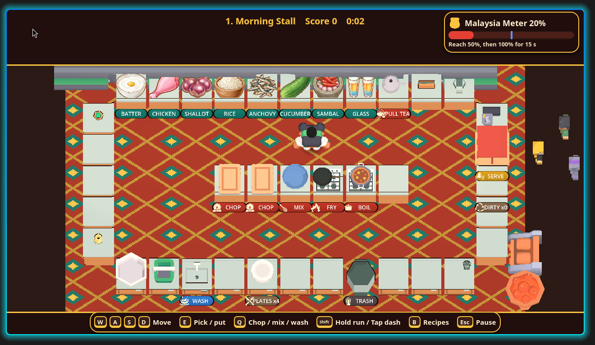

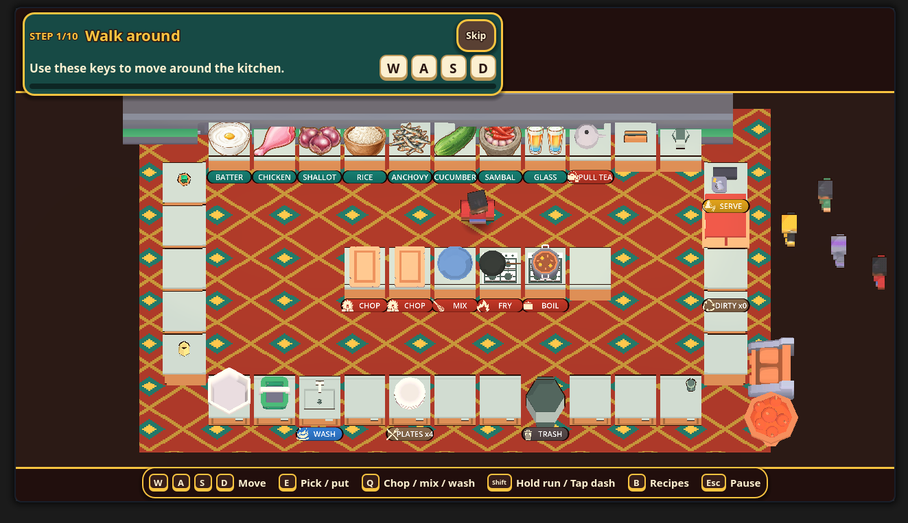

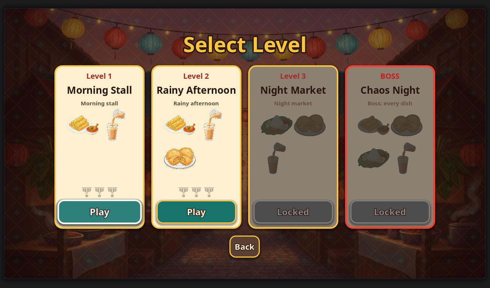

## Controls (defaults)

| Action | Player 1 | Player 2 |
| --- | --- | --- |
| Move | W A S D | Arrow keys |
| Pick up / put down | E | Enter |
| Chop / mix / wash / put out fire | Q | / |
| Hold to run, tap to dash | Shift | . |
| Recipe book | B | |
| Restart level | R | |
| Pause | Esc | |

All of these can be changed in Settings.

Pause and settings screenshots

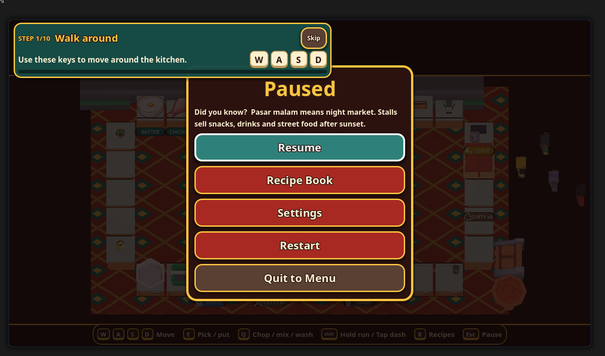
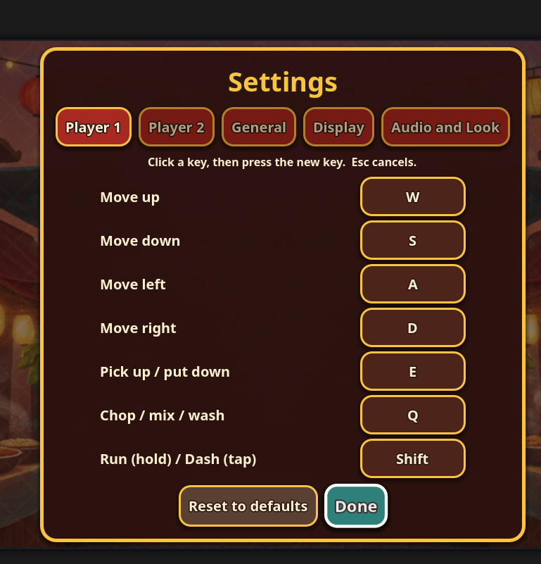
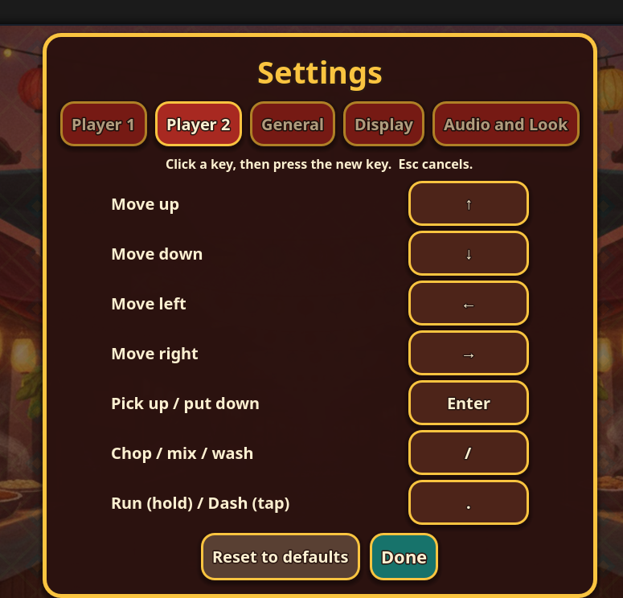
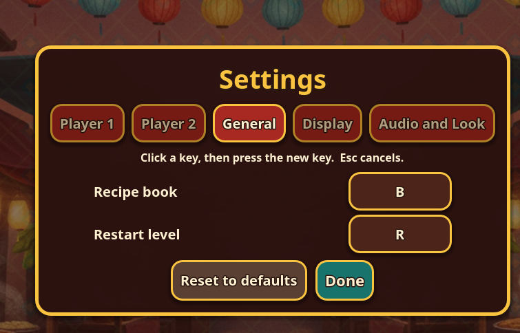
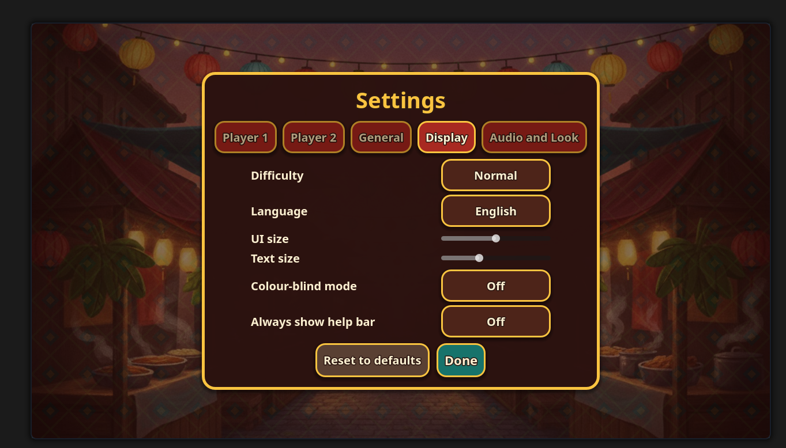
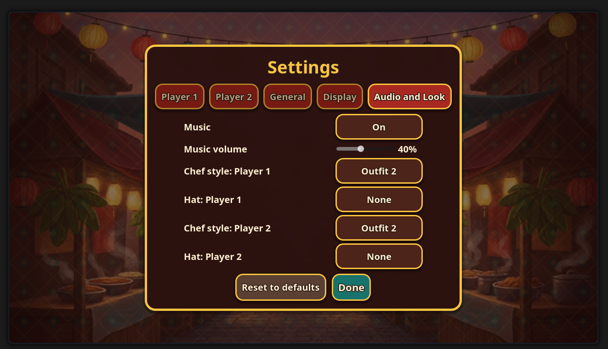

## Run it

1. Install [Godot 4.7](https://godotengine.org/download).
2. Clone this repo and open `project.godot` in the Godot editor.
3. Press F5.

The first open imports the assets, which takes a little while because of the 3D models and icon packs.

## Project layout

- `scripts/` game code (chef, stations, kitchen, game rules, menus, recipes, settings, sound)
- `scenes/` the main scene
- `shaders/` cel-shading and outline shaders
- `tools/playtest.gd` a headless smoke test: `godot --headless --path . --script res://tools/playtest.gd`
- `Assets/` models, icons, illustrations and fonts

## Status

This is a jam project. The automated playtest passes, but the game has had limited hand-playing, and co-op feel, ultrawide screens and exported builds are untested.

## Credits and licences

- **Game design and code:** Blakie (K1r4sh0) and NikDemirel12 (GitHub contributor: police chase, music settings, new title logo).
- **Engine:** Godot 4.7 (MIT).
- **3D models and UI:** Kenney (CC0): Food Kit, Mini Shop, Blocky Characters, Skyboxes, UI Pack, Input Prompts.
- **Icons:** game-icons.net (CC BY 3.0), including Lorc and Andy Meneely.
- **Font:** Noto Sans Bold (SIL OFL 1.1).
- **Dish, ingredient and logo illustrations:** generated with the jam-provided image model.

Full details in [CREDITS.md](CREDITS.md). Mostly Kenney (CC0) and game-icons.net (CC BY 3.0). Some asset folders do not ship with a licence file, so their authors are still unconfirmed; check them before redistributing.
