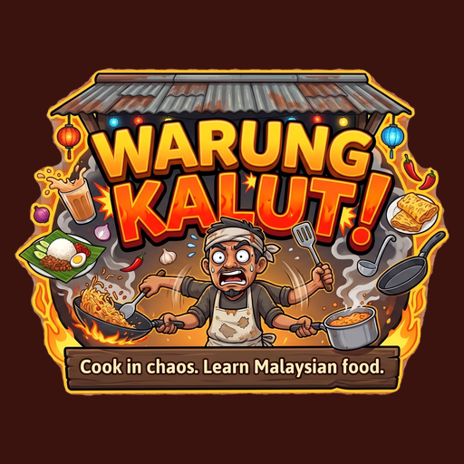

# Warung Kalut

A chaotic, co-op cooking game about Malaysian street food, inspired by Overcooked 2. Chop, mix, fry and boil your way through a warung while orders pile up, and learn what each dish is made of along the way.

Made in Godot 4.7 (GL Compatibility renderer, GDScript) for the Xsolla game jam.

## The game

- **Four dishes:** Roti Jala, Karipap, Nasi Lemak and Teh Tarik, each with a picture recipe and a short note about the dish.
- **Four levels:** Morning Stall, Rainy Afternoon, Night Market and a Chaos Night boss level that serves every dish. Levels unlock as you win and are scored in stars.
- **Training level** that walks you through moving, running, dashing, mixing, frying, plating and serving.
- **Kitchen chaos:** stations that chop, mix, fry, boil and wash, food that burns, fires you have to put out, oil spills and a growing pile of dirty plates.
- **1 or 2 players** on one keyboard.
- **Recipe book** (press B) with step-by-step visuals.
- **Settings:** rebindable controls for both players, English or Bahasa Melayu, UI and text size, colour-blind option, help bar toggle, and chef outfit and hat.

## Controls (defaults)

| Action | Player 1 | Player 2 |
| --- | --- | --- |
| Move | W A S D | Arrow keys |
| Pick up / put down | E | Enter |
| Chop / mix / wash / put out fire | Q | / |
| Hold to run, tap to dash | Shift | . |
| Recipe book | B | |
| Restart level | R | |
| Pause | Esc | |

All of these can be changed in Settings.

Settings screenshots

## Run it

1. Install [Godot 4.7](https://godotengine.org/download).
2. Clone this repo and open `project.godot` in the Godot editor.
3. Press F5.

The first open imports the assets, which takes a little while because of the 3D models and icon packs.

## Project layout

- `scripts/` game code (chef, stations, kitchen, game rules, menus, recipes, settings, sound)
- `scenes/` the main scene
- `shaders/` cel-shading and outline shaders
- `tools/playtest.gd` a headless smoke test: `godot --headless --path . --script res://tools/playtest.gd`
- `Assets/` models, icons, illustrations and fonts

## Status

This is a jam project. The automated playtest passes, but the game has had limited hand-playing, and co-op feel, ultrawide screens and exported builds are untested.

## Credits and licences

See [CREDITS.md](CREDITS.md). Mostly Kenney (CC0) and game-icons.net (CC BY 3.0). Some asset folders do not ship with a licence file, so their authors are still unconfirmed; check them before redistributing.
